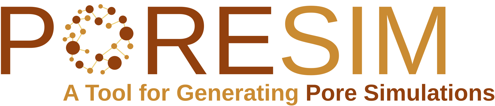

---

[](https://pypi.org/project/poresim/)
[](https://github.com/PoreMS/PoreSim/actions/workflows/ci.yml)
[](https://porems.github.io/PoreSim/)
[](https://github.com/PoreMS/PoreSim/actions/workflows/codeql.yml)
[](https://codecov.io/gh/PoreMS/PoreSim)
[](https://doi.org/10.5281/zenodo.17395962)
[](https://www.python.org/)
[](LICENSE)

<!-- start elevator-pitch -->

PoreSim is a Python package that sets up molecular dynamics simulations of pore
systems built with [PoreMS](https://porems.github.io/PoreMS/), as well as of
simple and two-phase boxes, for [GROMACS](https://www.gromacs.org/). It writes a
simulation folder that can be uploaded to a computing cluster as it is.
Features include:

- **Simulation boxes** around a PoreMS pore or an empty box, filled with any
  number of molecule types
    * a fixed number of molecules or a fill to a target density
    * placement in the pore, the reservoir, both, or as a layer on the wall
    * two-phase systems from areas or box dimensions
- **Topology** files and an index file assembled from the molecule topologies
- **Simulation parameters** for minimisation, NVT equilibration and production
  runs from mdp templates
- **Job scripts** for queuing systems such as SLURM, with the paths of the
  cluster directory and chained production runs
- **Benchmarks** to find the best number of nodes and processors
- **Analysis scripts** for the sampled trajectories with
  [PoreAna](https://porems.github.io/PoreAna/)

<!-- end elevator-pitch -->

## Installation

<!-- start installation -->

PoreSim targets Python 3.12 or 3.13

```bash
python -m pip install poresim
```

To install the current development version directly from GitHub instead:

```bash
python -m pip install git+https://github.com/PoreMS/PoreSim.git
```

<!-- end installation -->

## Usage

A detailed usage guide can be found in the
[documentation](https://porems.github.io/PoreSim/). It gives further information
on

- [Setting up a pore simulation](https://porems.github.io/PoreSim/simulation.html)
- [A complex pore system with several molecule types](https://porems.github.io/PoreSim/simulation_complex.html)
- [A two-phase system](https://porems.github.io/PoreSim/simulation_2ph.html)
- [API reference](https://porems.github.io/PoreSim/api.html)

## Development

PoreSim development takes place on GitHub:
[github.com/PoreMS/PoreSim](https://github.com/PoreMS/PoreSim). Please submit any
reproducible bugs you encounter to the
[issue tracker](https://github.com/PoreMS/PoreSim/issues).

The project uses [uv](https://docs.astral.sh/uv/) for environment and dependency
management:

```bash
uv sync --group dev          # create the environment with the test tools
uv run pytest                # run the test suite
uv run pytest --cov          # ... with a coverage report
uv run ruff check            # lint
uv run ruff format           # format
```

To build the documentation locally:

```bash
uv sync --group docs
uv run sphinx-build -b html docs/source docs/build
```

## Citation

If you use PoreSim in your research, please cite the
[Zenodo DOI](https://doi.org/10.5281/zenodo.17395962) of the version you used. The
metadata in [`CITATION.cff`](CITATION.cff) drives GitHub's "Cite this repository"
button.

## Legacy Code Notice

This repository contains the actively maintained and current codebase.
Earlier development stages and archived versions are stored in the following legacy repository:

[https://github.com/Ajax23/PoreSim](https://github.com/Ajax23/PoreSim)

Please note:
- Legacy versions are no longer actively maintained
- APIs, file formats, and dependencies may differ

## License

This project is licensed under GPL-3.0-or-later.
